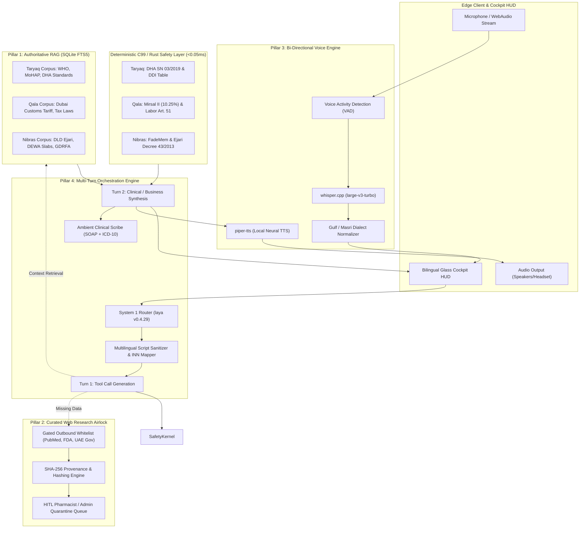

# 🏛️ PHASE 1: MASTER ARCHITECTURAL BLUEPRINT & SCHEMAS
## Dubai AI Agents Championship 2026–2027 (Dubai Future Foundation / DCDE)

**Document Reference:** `docs/PHASE_1_ARCHITECTURE_AND_SCHEMAS.md`  
**Founder & Principal Systems Architect:** Mohamed Fathy, BPharm (Licensed Clinical Pharmacist & Systems Architect)  
**Lead AI Orchestrator:** Antigravity (Google DeepMind Agentic Pair Programmer)  
**Date:** November 2026  
**Status:** **AUTHORITATIVE PHASE 1 SYSTEM ARCHITECTURE & SCHEMA SPECIFICATION**

---

## 1. Executive Overview & System Architecture

This specification establishes the architectural foundation for transitioning the **Tri-Modal Agent Network** (Taryaq, Qala, Nibras) from deterministic rule validation to an **autonomous, authoritative, multi-turn edge system**.

### System Architecture Diagram



---

## 2. Pillar 1: Authoritative Full-Scale RAG Pipeline

### A. Corpus Catalog & Statutory Provenance
All knowledge in the system must stem from primary authoritative sources. No synthesized third-party blog posts or secondary opinions are accepted.

| Agent | Primary Document | Authority / Origin | Legal / Regulatory Basis | Ingestion Format |
| :--- | :--- | :--- | :--- | :--- |
| **Taryaq** | WHO Model Formulary & EML 2023–2025 | World Health Organization | Global Clinical Benchmark | Structured JSON / FTS5 |
| **Taryaq** | UAE Registered Products List 2024–2026 | UAE MoHAP | Federal Law 8/2019 | Tabular FTS5 |
| **Taryaq** | DHA Clinical Standards & Circulars | Dubai Health Authority | DHA SN 03/2019 | Clause-chunked FTS5 |
| **Qala** | Integrated Customs Tariff Schedule 2026 | Dubai Customs | Mirsal II / GCC Unified Tariff | HS Code indexed FTS5 |
| **Qala** | UAE Labor Law Executive Regulations | MoHRE | Federal Decree-Law 33/2021 | Article-chunked FTS5 |
| **Qala** | UAE Corporate Tax & VAT Guidelines | Federal Tax Authority | Federal Decree-Law 47/2022 | Decree-chunked FTS5 |
| **Nibras** | Ejari Rental Index & Increase Calculator | Dubai Land Department | Decree 43/2013 | Tier-bracket FTS5 |
| **Nibras** | DEWA Slab Tariff & Green Charger Rules | DEWA | Dubai Supreme Council of Energy | Slab-bracket FTS5 |

### B. Unified SQLite FTS5 Schema Specification (`corpus/rag_master.db`)

```sql
-- Master Table of Registered Authoritative Documents
CREATE TABLE IF NOT EXISTS rag_documents (
    doc_id TEXT PRIMARY KEY,               -- e.g. 'DHA-SN-03-2019', 'MOHAP-FORMULARY-2026'
    domain TEXT NOT NULL,                  -- 'CLINICAL', 'CUSTOMS', 'LABOR', 'CIVIC'
    title TEXT NOT NULL,                   -- Official document title
    issuing_authority TEXT NOT NULL,       -- 'DHA', 'MOHAP', 'WHO', 'DUBAI_CUSTOMS', 'DLD'
    effective_date TEXT NOT NULL,          -- ISO 8601 YYYY-MM-DD
    source_url TEXT,                       -- Primary official portal link
    file_sha256 TEXT NOT NULL,             -- Cryptographic digest of source PDF/document
    total_chunks INTEGER NOT NULL DEFAULT 0,
    created_at TEXT NOT NULL DEFAULT (datetime('now', 'utc'))
);

-- Individual Atomic Chunks with Statutory Offset
CREATE TABLE IF NOT EXISTS rag_chunks (
    chunk_id TEXT PRIMARY KEY,             -- e.g. 'DHA-SN-03-2019:SEC-4.2'
    doc_id TEXT NOT NULL REFERENCES rag_documents(doc_id) ON DELETE CASCADE,
    domain TEXT NOT NULL,
    section_code TEXT NOT NULL,            -- e.g. 'ARTICLE_51', 'SECTION_4.2', 'HS_8517'
    title TEXT NOT NULL,                   -- Heading / Topic title
    passage TEXT NOT NULL,                 -- Full-text statutory or monograph excerpt
    passage_sha256 TEXT NOT NULL,          -- SHA-256 hash of this specific passage
    token_count INTEGER NOT NULL,
    reserved_embedding BLOB,               -- Reserved for 768-dim ModernBERT/nomic vector
    created_at TEXT NOT NULL DEFAULT (datetime('now', 'utc'))
);

-- Full-Text Search Virtual Table (SQLite FTS5 with BM25 Ranking)
CREATE VIRTUAL TABLE IF NOT EXISTS rag_chunks_fts USING fts5(
    chunk_id UNINDEXED,
    doc_id UNINDEXED,
    domain,
    section_code,
    title,
    passage,
    content='rag_chunks',
    content_rowid='rowid',
    tokenize='unicode61 remove_diacritics 2'
);

-- Triggers for FTS5 Synchronization
CREATE TRIGGER IF NOT EXISTS rag_chunks_ai AFTER INSERT ON rag_chunks BEGIN
    INSERT INTO rag_chunks_fts(rowid, chunk_id, doc_id, domain, section_code, title, passage)
    VALUES (new.rowid, new.chunk_id, new.doc_id, new.domain, new.section_code, new.title, new.passage);
END;

CREATE TRIGGER IF NOT EXISTS rag_chunks_ad AFTER DELETE ON rag_chunks BEGIN
    INSERT INTO rag_chunks_fts(rag_chunks_fts, rowid, chunk_id, doc_id, domain, section_code, title, passage)
    VALUES ('delete', old.rowid, old.chunk_id, old.doc_id, old.domain, old.section_code, old.title, old.passage);
END;

CREATE TRIGGER IF NOT EXISTS rag_chunks_au AFTER UPDATE ON rag_chunks BEGIN
    INSERT INTO rag_chunks_fts(rag_chunks_fts, rowid, chunk_id, doc_id, domain, section_code, title, passage)
    VALUES ('delete', old.rowid, old.chunk_id, old.doc_id, old.domain, old.section_code, old.title, old.passage);
    INSERT INTO rag_chunks_fts(rowid, chunk_id, doc_id, domain, section_code, title, passage)
    VALUES (new.rowid, new.chunk_id, new.doc_id, new.domain, new.section_code, new.title, new.passage);
END;
```

---

## 3. Pillar 2: Curated Web Research Airlock

### A. Outbound Gated Whitelist Policy
The agent runs in a sovereign enclave. When authoritative local RAG does not contain required dynamic intelligence (e.g. newly published drug safety alert, recent customs tariff circular), the agent is permitted outbound requests **only** to strictly whitelisted domain endpoints.

```
WHITELIST_DOMAINS = {
    "ncbi.nlm.nih.gov":    ["/entrez/eutils/esearch.fcgi", "/entrez/eutils/efetch.fcgi"],
    "api.fda.gov":         ["/drug/label.json", "/drug/event.json", "/drug/enforcement.json"],
    "who.int":             ["/entity/medicines/", "/news/"],
    "mohap.gov.ae":        ["/en/services/", "/ar/services/"],
    "dha.gov.ae":          ["/en/HealthRegulation/", "/ar/HealthRegulation/"],
    "dubaicustoms.gov.ae": ["/en/CustomsTariff/", "/ar/CustomsTariff/"]
}
```

Any request directed to unapproved IP addresses, non-whitelisted domains, or arbitrary search engines (e.g. Google, Bing) is immediately blocked by the network guardrail with an `AIRLOCK_ACCESS_VIOLATION` security alert.

### B. Airlock Audit & Quarantine Schema (`corpus/airlock_ledger.db`)

```sql
-- Outbound Request Audit Log
CREATE TABLE IF NOT EXISTS airlock_requests (
    request_id TEXT PRIMARY KEY,           -- UUIDv4
    agent_id TEXT NOT NULL,                -- 'TARYAQ', 'QALA', 'NIBRAS'
    target_domain TEXT NOT NULL,           -- e.g. 'ncbi.nlm.nih.gov'
    endpoint_path TEXT NOT NULL,
    http_method TEXT NOT NULL DEFAULT 'GET',
    query_params_json TEXT NOT NULL,
    trigger_reason TEXT NOT NULL,          -- e.g. 'DDI_UNMODELED_CLARITHROMYCIN_VERIFICATION'
    requested_at TEXT NOT NULL DEFAULT (datetime('now', 'utc'))
);

-- Cryptographically Hashed Inbound Responses
CREATE TABLE IF NOT EXISTS airlock_responses (
    response_id TEXT PRIMARY KEY,          -- UUIDv4
    request_id TEXT NOT NULL REFERENCES airlock_requests(request_id),
    http_status INTEGER NOT NULL,
    headers_json TEXT NOT NULL,
    payload_raw BLOB NOT NULL,
    payload_sha256 TEXT NOT NULL,          -- SHA-256 for chain-of-custody verification
    received_at TEXT NOT NULL DEFAULT (datetime('now', 'utc'))
);

-- Human-In-The-Loop (HITL) Staging Quarantine
CREATE TABLE IF NOT EXISTS airlock_quarantine (
    quarantine_id TEXT PRIMARY KEY,
    response_id TEXT NOT NULL REFERENCES airlock_responses(response_id),
    target_table TEXT NOT NULL,            -- e.g. 'taryaq_ddi_rules', 'customs_tariffs'
    extracted_data_json TEXT NOT NULL,     -- Proposed schema insertion
    status TEXT NOT NULL DEFAULT 'STAGED', -- 'STAGED', 'APPROVED', 'REJECTED'
    reviewer_role TEXT,                    -- 'LICENSED_CLINICAL_PHARMACIST', 'CUSTOMS_OFFICER'
    reviewer_notes TEXT,
    reviewed_at TEXT,
    created_at TEXT NOT NULL DEFAULT (datetime('now', 'utc'))
);

CREATE INDEX IF NOT EXISTS idx_quarantine_status ON airlock_quarantine(status);
```

---

## 4. Pillar 3: Bi-Directional Voice Engine

### A. Audio Processing Pipeline
```
[Microphone / WebAudio Client]
      │ (16kHz 16-bit Mono PCM)
      ▼
[Voice Activity Detection (VAD)] ── Silence (>450ms) ──► Utterance Sealed
      │
      ▼
[whisper.cpp Engine]
  - Model: ggml-large-v3-turbo-q5_0.bin
  - Runtime: AMD Ryzen 9 7940HS (AVX-512, 8 threads)
  - Latency: <180 ms for 3-second utterance
      │
      ▼ (Raw Arabic / English Transcript)
[Dialectal Normalizer (Gulf/Masri)]
  - Maps phonetic vernacular to canonical medical & statutory terminology
      │
      ▼
[Conversational Bridge] ── Turn Processing ──► [piper-tts Engine]
                                                - Model: ar_JO-kareem-medium / en_US-lessac
                                                - Latency: <95 ms first-chunk
                                                - Audio Out: 22.05 kHz WAV / OPUS stream
```

### B. Dialect Normalizer Entity Matrix
Patients and traders communicate in Gulf and Egyptian vernacular. The system normalizes these without changing conversational sentiment:

| Vernacular Utterance (Gulf/Masri) | Phonetic Script | Canonical Medical / Legal Entity | Target Module |
| :--- | :--- | :--- | :--- |
| عظامي بتوجعني وعندي نقرس حاد | Gout / Joint pain | `ICD-10 M10.9 (Gout, unspecified)` | Taryaq |
| باخد حبة كولشيسين مع كلاريثرو | Colchicine + Clarithro | `Colchicine` + `Clarithromycin` | Taryaq DDI |
| كليتي تعبانة والفحص 22 | Kidney tired, test 22 | `Renal Impairment (eGFR 22 mL/min)` | Taryaq Safety |
| عايز ادخل شحنة موبايلات من المينا | Port mobile shipment | `HS 8517.13.00 (Smartphones)` | Qala Mirsal II |
| صاحب الشقة رفع عليا الايجار 20% | Landlord raised rent 20% | `DLD Ejari Decree 43/2013 Dispute` | Nibras Civic |

---

## 5. Pillar 4: Conversational Tri-Modal Copilot & Scribe

### A. 2-Stage Multi-Turn Orchestration Protocol
To eliminate the forensic failure where raw JSON was emitted with an immediate `[DONE]`:

1. **Turn 1 (Tool Proposal):**
   - User inputs voice or text.
   - Script Sanitizer strips invalid alphabets (Katakana, Cyrillic) and maps Arabic drug names to canonical INN.
   - System 1 Router (`laya v0.4.29`) tags intent: `CASUAL_CONVERSATION` vs. `CLINICAL_EVALUATION` vs. `BUSINESS_TRANSACTION`.
   - If casual greeting $\rightarrow$ LLM responds directly without medical over-priming.
   - If clinical/business $\rightarrow$ LLM generates deterministic tool invocation: `interaction_check(...)`.

2. **Safety Kernel Intercept:**
   - Bridge calls C99/Rust library via FFI (`<0.05 ms`).
   - C99 returns deterministic verdict: `CRITICAL_CONTRAINDICATION_FATAL`.

3. **Turn 2 (Conversational Synthesis):**
   - The Bridge constructs a second turn context:
     ```json
     {
       "role": "tool_verdict",
       "content": {
         "status": "CONTRAINDICATED_FATAL",
         "primary_drug": "Colchicine",
         "concurrent_drug": "Clarithromycin",
         "egfr": 22,
         "mechanism": "Severe CYP3A4 and P-glycoprotein inhibition leading to life-threatening colchicine accumulation and multi-organ failure in renal impairment.",
         "statutory_ref": "DHA SN 03/2019 / FDA Black Box Warning"
       }
     }
     ```
   - LLM generates a bilingual, empathetic, clinically authoritative response explaining the danger, advising immediate stoppage, and providing the patient companion with next steps.

### B. Ambient Clinical Scribe Schema (SOAP Notes & DHA Billing)

```sql
CREATE TABLE IF NOT EXISTS clinical_soap_notes (
    note_id TEXT PRIMARY KEY,              -- UUIDv4
    encounter_id TEXT NOT NULL,
    patient_identifier_hash TEXT NOT NULL, -- SHA-256 pseudonymized under UAE PDPL
    clinician_id TEXT NOT NULL,
    subjective_text TEXT NOT NULL,         -- Chief complaint, history of presenting illness
    objective_text TEXT NOT NULL,          -- Labs, vitals, current medication list
    assessment_text TEXT NOT NULL,         -- Clinical assessment, interaction alerts
    plan_text TEXT NOT NULL,               -- Interventions, therapeutic changes
    icd10_codes_json TEXT NOT NULL,        -- Array of matched ICD-10 codes
    dha_claim_codes_json TEXT NOT NULL,    -- Matched DHA billing codes
    signed_off_by_clinician INTEGER DEFAULT 0,
    created_at TEXT NOT NULL DEFAULT (datetime('now', 'utc'))
);
```

---

## 6. Implementation Roadmap: Phase 1 Work Breakdown

Following the **1 session = 1 feature/part** rule, Phase 1 is executed across three dedicated implementation sessions:

| Session Ref | Focus Area | Detailed Output |
| :--- | :--- | :--- |
| **Phase 1-A** | **Unified SQLite Schemas & Migration** | Implement `corpus/rag_master.db` & `corpus/airlock_ledger.db` with FTS5 triggers and C99/Python bindings. |
| **Phase 1-B** | **Knowledge Ingestion & Corpus Compiler** | Build Python ingestion pipeline converting WHO EML, DHA Standards, MoHAP Formulary, and Dubai Customs Tariff into chunked FTS5 records. |
| **Phase 1-C** | **Multi-Turn Bridge & Script Sanitizer** | Update `bridge/server.py` and `bridge/openrouter_client.py` with 2-Stage Multi-Turn execution, Katakana rejection, and bilingual synthesis loop. |

---

## 7. Architectural Decision Confirmation

1. **RAG Architecture:** Standalone SQLite FTS5 with BM25 ranking (zero daemon, instant C99/Python interoperability), with reserved BLOB fields for optional local vector embeddings.
2. **Airlock Security:** Outbound HTTPS from the Edge Appliance gated strictly to whitelisted domains (`ncbi.nlm.nih.gov`, `api.fda.gov`, `mohap.gov.ae`, `dha.gov.ae`, `dubaicustoms.gov.ae`), with every payload signed via SHA-256 into the quarantine ledger.
3. **Voice Engine:** `whisper.cpp` (`large-v3-turbo`) for input STT paired with `piper-tts` (standalone C++ ONNX binary) for low-latency Arabic and English speech synthesis.
