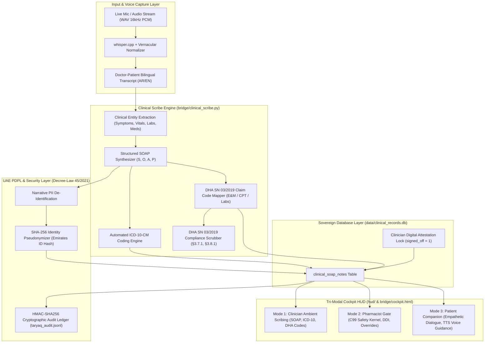

# 🏛️ PHASE 5: MASTER ARCHITECTURAL BLUEPRINT & IMPLEMENTATION PLAN
## Conversational Tri-Modal Copilot & Ambient Clinical Scribing (SPRINT-15 / M-15)
### Dubai AI Agents Championship 2026–2027 (Dubai Future Foundation / DCDE)

**Document Reference:** `docs/PHASE_5_ARCHITECTURE_AND_PLAN.md`  
**Founder & Principal Systems Architect:** Mohamed Fathy, BPharm (Licensed Clinical Pharmacist & Systems Architect)  
**Lead AI Orchestrator:** Antigravity (Google DeepMind Agentic Pair Programmer)  
**Date:** November 2026  
**Status:** **AUTHORITATIVE MASTER SPECIFICATION & IMPLEMENTATION DIRECTIVE**  
**Operating Directive:** Strict rule: 1 session = 1 feature/part. The Orchestrator plans, architectures, and prompts; dedicated Implementation Sessions execute code, run tests, and merge PRs.

---

## 1. Executive Context & Baseline Absorption Confirmation

### 1.1 Baseline Verification (Milestones M-00 through M-14)
The Master Control Plane at `/Users/mohamedfathy/Desktop/Dubai` (branch `main`, clean working tree) has successfully absorbed and verified all prior milestones:
1. **Foundation & Safety Kernels (SPRINT-00 – SPRINT-10):**
   - 137/137 Rust tests passing across Taryaq (88), Qala (21), and Nibras (28).
   - 399 C99 deterministic safety assertions passing with zero compiler warnings (`-Wall -Wextra -Werror`).
   - C99 Microsecond Safety Intercept: DDI checks (<0.02 ms), Mirsal II 10.25% landed duty, Labor Article 51 gratuity, and FadeMem cognitive decay ($R = e^{-t/S}$).
   - AES-256-GCM authenticated encryption for Nibras Sovereign Vault under UAE PDPL.
2. **Phase 1: SQLite Schemas, Knowledge Ingestion & Script Sanitizer (SPRINT-11-A, B, C):**
   - Physical schemas initialized for `corpus/rag_master.db`, `corpus/airlock_ledger.db`, and `data/clinical_records.db`.
   - 38 authoritative statutory chunks indexed with SQLite FTS5 BM25.
   - Multilingual Script Sanitizer stripping unauthorized Japanese/Katakana scripts and normalizing Arabic/English INN drug entities.
3. **Phase 2: Dynamic RAG Runtime Integration (SPRINT-12):**
   - Sub-millisecond BM25 statutory citation engine with SHA-256 passage verification for DHA SN 03/2019, Drug Monographs, Customs Tariffs, and Ejari Decree 43/2013.
4. **Phase 3: Curated Web Research Airlock Engine (SPRINT-13):**
   - Cryptographic gated outbound HTTP client strictly restricted to 6 official domains (PubMed, OpenFDA, WHO, MOHAP, DHA, Dubai Customs).
   - SHA-256 response payload hashing, provenance tracking, and HITL pharmacist quarantine airlock.
5. **Phase 4: Bi-Directional Voice Engine (SPRINT-14):**
   - Local STT integration via `whisper.cpp` (`large-v3-turbo` model) with PCM 16 kHz 16-bit mono validation.
   - Gulf/Masri vernacular dialect normalizer extracting clinical entities and converting vernacular terms to canonical INN concepts.
   - Low-latency Piper neural TTS synthesis with WAV stream delivery.
   - Real-time Cockpit Live Mic interface in `bridge/cockpit.html` and `hud/glass_cockpit_hud.html`.

### 1.2 Handover Mission: Phase 5 (SPRINT-15 / M-15)
With the voice engine, RAG runtime, and safety kernels fully operational, the system is primed for **Phase 5: Conversational Tri-Modal Copilot & Ambient Clinical Scribing**. This phase closes the clinical loop by transforming continuous doctor-patient spoken dialogues into fully structured, auditable, and statutory-compliant medical encounters.

---

## 2. Phase 5 System Architecture & Dataflow Topology



---

## 3. Subsystem Specifications

### Subsystem A: Ambient Dialogue Ingestion & Bilingual Vernacular Parsing
- **Module:** `bridge/clinical_scribe.py`
- **Responsibilities:**
  1. Accept continuous multi-turn dialogue text containing alternating physician/patient speech turns in English, Modern Standard Arabic (MSA), or vernacular Gulf/Egyptian Arabic (e.g., *"عندي ألم فظيع في صباع رجلي الكبير ومبقدرش أدوس عليه... وعندي وظائف كلى تعبانة وبغسل أو eGFR 22"*).
  2. Leverage `bridge/sanitizer.py` entity extraction (`extract_vernacular_entities`, `normalize_drug_name`, `strip_unauthorized_scripts`) to identify:
     - Chief Complaints & Symptoms (e.g., severe joint pain, erythema, swelling, dyspnea, fever).
     - Quantitative Laboratory Data (e.g., eGFR = 22 mL/min, Uric acid = 9.2 mg/dL, Creatinine = 2.4 mg/dL, HbA1c = 8.1%).
     - Quantitative Vitals (e.g., BP 145/92 mmHg, HR 88 bpm, SpO2 97%, Temp 37.2°C).
     - Concurrent and Prescribed Medications (e.g., Colchicine 0.5mg, Clarithromycin 500mg, Allopurinol, Prednisolone).
     - Known Allergies & Clinical History (e.g., CKD Stage 4, Peptic Ulcer Disease).

### Subsystem B: Structured SOAP Clinical Note Synthesis
- **Output Data Structure (`SOAPNote`):**
  1. **Subjective (S):**
     - Chief Complaint (CC): Primary presenting issue stated succinctly.
     - History of Presenting Illness (HPI): Onset, location, duration, character, aggravating/relieving factors, radiation, temporal pattern, severity (OLDCARTS).
     - Review of Systems (ROS) & Patient-reported compliance/allergies.
  2. **Objective (O):**
     - Vital Signs: Formatted, standardized string (BP, HR, RR, Temp, SpO2).
     - Physical Examination: Target findings extracted from dialogue.
     - Laboratory & Diagnostic Results: Categorized table of relevant values with units and reference flags.
     - Current Medication Reconciliation: Active drug, dose, route, frequency.
  3. **Assessment (A):**
     - Primary Clinical Diagnosis: Specific clinical diagnostic statement.
     - Differential Diagnoses: Secondary suspected conditions.
     - Pharmacotherapeutic & Pharmacovigilance Evaluation: Real-time integration with Taryaq C99 safety engine (`rx_prescribe` / `interaction_check`), highlighting fatal/severe contraindications (e.g., **FATAL CYP3A4 + RENAL CONTRAINDICATION: Colchicine contraindicated with strong CYP3A4 inhibitors like Clarithromycin in renal impairment eGFR < 30 mL/min**).
  4. **Plan (P):**
     - Pharmacotherapy Adjustments: Explicit "HOLD", "DISCONTINUE", "INITIATE", or "DOSE-ADJUST" directives with clinical rationales.
     - Diagnostic & Laboratory Orders: Monitoring parameters (e.g., repeat eGFR/serum creatinine in 48-72h, serum uric acid level).
     - Non-Pharmacological Interventions: Hydration, dietary purine avoidance, rest/elevation.
     - Patient Education & Red Flags: Specific emergency instructions.
     - Follow-Up: Recommended clinical review interval.

### Subsystem C: Statutory Diagnostic & Claim Coding Engine
- **ICD-10-CM Coding Engine:**
  - Automated mapping of extracted clinical diagnoses to valid ICD-10-CM codes with description and confidence:
    * `M10.9`: Gout, unspecified (or `M10.00` Idiopathic gout, unspecified site)
    * `N18.4`: Chronic kidney disease, stage 4 (severe, eGFR 15-29 mL/min)
    * `J06.9`: Acute upper respiratory infection, unspecified
    * `I10`: Essential (primary) hypertension
    * `E11.9`: Type 2 diabetes mellitus without complications
    * `T88.7XXA`: Adverse effect of drug or medicament, initial encounter
- **DHA SN 03/2019 Claim Code & Billing Rules Mapper:**
  - Official Dubai Health Post Office (DHPO) / eClaimLink claim line items:
    * **Evaluation & Management (E&M) CPT Codes:**
      - `99203`: Office/outpatient visit, new patient, low-moderate complexity (30 min)
      - `99204`: Office/outpatient visit, new patient, moderate-high complexity (45 min)
      - `99213`: Office/outpatient visit, established patient, low-moderate complexity (15 min)
      - `99214`: Office/outpatient visit, established patient, moderate-high complexity (25 min)
      - `99215`: Office/outpatient visit, established patient, high complexity / extensive medical decision making (40 min)
    * **Diagnostic Laboratory CPT Codes:**
      - `80053`: Comprehensive Metabolic Panel (CMP - includes electrolytes, BUN, creatinine, eGFR, LFTs)
      - `84550`: Uric Acid; blood
      - `85025`: Complete Blood Count (CBC) with automated differential
    * **Statutory Compliance & Penalty Validation per DHA SN 03/2019:**
      - **Section 3.7.1:** Initial claim submission must occur within **14 calendar days** of the encounter date.
      - **Section 3.7.2:** Claims submitted beyond 14 calendar days incur initial submission delay penalty exposure and potential denial.
      - **Section 3.8.1:** Resubmissions must be uploaded within **30 calendar days** of payer remittance rejection.
      - **Section 3.8.2:** Maximum resubmission threshold is strictly capped at **2 resubmissions** per encounter.
      - The claim engine automatically flags encounters approaching the 14-day window and generates the structured JSON claim package.

### Subsystem D: UAE PDPL (Federal Decree-Law 45/2021) & Security Persistence
- **Statutory Mandate:** UAE Federal Decree-Law No. 45 of 2021 on Personal Data Protection (PDPL), Article 5 (Principles of Personal Data Processing) and Article 13 (Security and Confidentiality of Personal Data), alongside DESC ISR v3.1.
- **Cryptographic Pseudonymization Workflow:**
  1. **Identity Sanitization:** Emirates ID (e.g., `784-1985-1234567-1`) is NEVER stored in plaintext. It is normalized and hashed via SHA-256:
     $$\text{patient\_identifier\_hash} = \text{SHA-256}(\text{canonical\_emirates\_id})$$
  2. **Narrative De-Identification:** Any civilian full names, phone numbers, or residential addresses spoken in dialogue are redacted from the stored `subjective_text` and `objective_text` (e.g. replaced with `[PATIENT_NAME_REDACTED]`).
  3. **Physical Storage:** Committed to `data/clinical_records.db` in table `clinical_soap_notes`:
     - `note_id`: UUIDv4 primary key
     - `encounter_id`: e.g., `ENC-2026-XXXX`
     - `patient_identifier_hash`: 64-character SHA-256 hex string
     - `clinician_id`: e.g., `DHA-MD-88124`
     - `subjective_text`: Redacted narrative
     - `objective_text`: Standardized clinical metrics
     - `assessment_text`: Clinical assessment with contraindication alerts
     - `plan_text`: Actionable interventions
     - `icd10_codes_json`: Serialized JSON array of matched ICD-10 objects
     - `dha_claim_codes_json`: Serialized JSON array of DHA claim objects with SN 03/2019 validation
     - `signed_off_by_clinician`: 0 (draft) or 1 (attested)
     - `created_at`: UTC ISO-8601 timestamp
  4. **Tamper-Evident Ledger:** Every committed SOAP note emits a record to `taryaq_audit.jsonl` containing the SHA-256 hash of the entire record, cryptographically chained to previous entries.

### Subsystem E: Tri-Modal Interface Orchestration (Cockpit HUD)
The Glass Cockpit HUD (`bridge/cockpit.html` and `hud/glass_cockpit_hud.html`) introduces a responsive, zero-latency **Tri-Modal State Switcher**:
1. **Mode 1: Clinician Ambient Scribing (`mode: clinician`)**
   - **Primary User:** Attending physician, consultant, or hospital clinician.
   - **View:** Active listening panel with real-time waveform, split-screen live transcription, dynamically rendered SOAP note card, automated ICD-10 and DHA claim code tags, and a prominent green **"Sign & Lock Note"** button.
   - **Safety Integration:** Real-time red warning banners when prescribed medications trigger C99 contraindication blocks.
2. **Mode 2: Pharmacist Gate (`mode: pharmacist`)**
   - **Primary User:** Clinical pharmacist in dispensary or hospital pharmacy.
   - **View:** Pharmacovigilance safety kernel console, sub-millisecond C99 DDI verification badge (<0.02 ms), DHA SN 03/2019 pre-authorization audit, single-use emergency override console (`TARYAQ-OVERRIDE-*`), and Curated Web Airlock quarantine queue review.
3. **Mode 3: Patient Companion (`mode: patient`)**
   - **Primary User:** Patient or family caregiver at home/bedside.
   - **View:** High-accessibility, large-typography, bilingual interface. Deconstructs complex medical jargon into clear, compassionate instructions in spoken Arabic (Gulf/Egyptian) and English.
   - **Features:** Medication schedule ("Take 1 tablet after breakfast"), dietary warnings ("Avoid grapefruit and red meat"), emergency red-flag symptoms ("Go to ER if chest pain or severe shortness of breath occurs"), and one-click Piper TTS audio playback for all instructions.

### Subsystem F: HTTP & SSE API Endpoints (`bridge/server.py`)
| Method | Endpoint | Description | Payload / Response |
| :--- | :--- | :--- | :--- |
| `POST` | `/api/clinical/soap/generate`<br>*(alias: `/api/clinical/soap/parse`)* | Parses conversational transcript into structured SOAP note + ICD-10 diagnostic codes & DHA claim reconciliation | **Req:** `{"transcript": "...", "encounter_id": "...", "patient_id": "...", "clinician_id": "..."}`<br>**Resp:** `{"soap": {...}, "icd10": [...], "dha_claims": [...], "safety_alerts": [...]}` |
| `POST` | `/api/clinical/soap/commit` | Pseudonymizes and persists SOAP note to `data/clinical_records.db` | **Req:** Complete SOAP JSON payload with `patient_id` or `patient_identifier_hash`<br>**Resp:** `{"status": "COMMITTED", "note_id": "...", "patient_hash": "..."}` |
| `GET` | `/api/clinical/soap/notes`<br>*(alias: `/api/clinical/soap/list`)* | Retrieves past patient SOAP records with optional filters | **Params:** `?limit=20&patient_hash=...`<br>**Resp:** `[{"note_id": "...", "encounter_id": "...", "created_at": "...", "signed_off": 1, "icd10": [...]}]` |
| `GET` | `/api/clinical/soap/{note_id}` | Retrieves full structured SOAP note by note ID | **Resp:** Complete SOAP JSON object |
| `POST` | `/api/clinical/soap/signoff`<br>*(alias: `/api/clinical/soap/{note_id}/sign`)* | Clinician digital sign-off and record locking | **Req:** `{"note_id": "...", "clinician_id": "...", "signature_token": "..."}`<br>**Resp:** `{"status": "SIGNED", "note_id": "...", "locked": true}` |
| `GET` | `/api/clinical/mode` | Gets current active UI mode | **Resp:** `{"mode": "clinician" \| "pharmacist" \| "patient"}` |
| `POST` | `/api/clinical/mode` | Sets current active UI mode | **Req:** `{"mode": "clinician" \| "pharmacist" \| "patient"}`<br>**Resp:** `{"mode": "...", "status": "MODE_SWITCHED"}` |

---

## 4. Statutory Traceability Matrix

| Requirement | Statutory Authority / Standard | Technical Enforcement Mechanism |
| :--- | :--- | :--- |
| **Patient Data Privacy** | UAE Federal Decree-Law No. 45 of 2021 (PDPL), Arts. 5 & 13 | Irreversible SHA-256 pseudonymization of Emirates ID; regex redaction of civilian names and phone numbers in narrative text. |
| **Data Residency & Security** | Dubai Electronic Security Center (DESC) ISR v3.1 | Pure local SQLite database (`data/clinical_records.db`), zero cloud leak, local file permissions (`0600`). |
| **Claim Submission Timelines** | Dubai Health Authority (DHA) Standards Notice SN 03/2019 §3.7.1 | Automatic 14-day claim window tracker; alert generation for delayed encounters. |
| **Resubmission Limits** | DHA SN 03/2019 §3.8.1 & §3.8.2 | Hard validation capping resubmissions at 2; 30-day resubmission window enforcement. |
| **Diagnostic Coding** | WHO / CDC ICD-10-CM Standard | Automated mapping with confidence scoring and clinical description matching. |
| **Billing Codes** | DHA / DHPO Approved CPT / HCPCS Coding Manual | Automated E&M code assignment (99203-99215) and laboratory CPT codes (80053, 84550, 85025). |
| **Pharmacovigilance Safety** | FDA Boxed Warnings, BNF 84, KDIGO 2024 Guidelines | Real-time C99 safety engine intercept (<0.02 ms) embedded directly into SOAP Assessment. |

---

## 5. Verification Battery & Test Specifications (`tests/test_clinical_scribe.py`)

A comprehensive test suite of at least 7 deterministic tests must be implemented:
1. `test_ambient_dialogue_to_soap_parsing`: Verifies parsing of a full bilingual doctor-patient transcript (gout + CKD + clarithromycin) into distinct S, O, A, P components.
2. `test_icd10_coding_accuracy`: Verifies correct extraction of `M10.9` (Gout) and `N18.4` (CKD Stage 4) with appropriate confidence metrics.
3. `test_dha_sn_03_2019_claim_mapping`: Verifies mapping of E&M code `99214` and lab codes `80053`, `84550` along with DHA §3.7.1 initial submission deadline calculation.
4. `test_uae_pdpl_sha256_pseudonymization`: Verifies that plaintext Emirates IDs (`784-1985-1234567-1`) are never written to the DB in plaintext and are strictly stored as 64-character SHA-256 hashes.
5. `test_soap_database_commit_and_retrieval`: Verifies end-to-end persistence to `data/clinical_records.db`, including reading, sign-off locking, and idempotency.
6. `test_tri_modal_mode_switching`: Verifies mode state management (`clinician`, `pharmacist`, `patient`) and appropriate UI/payload filtering.
7. `test_rest_api_soap_endpoints`: Uses Python standard library test client to verify `POST /api/clinical/soap/parse`, `POST /api/clinical/soap/commit`, and `GET /api/clinical/soap/{note_id}`.

---

## 6. Implementation Session Execution Blueprint

### 6.1 Execution Phasing (Single Implementation Session)
The implementation agent will execute the following concrete steps:
- **Part 1:** Create `bridge/clinical_scribe.py` with the complete dialogue parser, SOAP synthesizer, ICD-10 engine, and DHA SN 03/2019 claim mapper (Zero external pip dependencies).
- **Part 2:** Wire the new endpoints into `bridge/server.py` (`/api/clinical/soap/*`, `/api/clinical/mode`) and connect to `data/clinical_records.db`.
- **Part 3:** Update `bridge/cockpit.html` and `hud/glass_cockpit_hud.html` with the Tri-Modal UI switcher and dedicated panels for Clinician Scribing, Pharmacist Gate, and Patient Companion.
- **Part 4:** Create `tests/test_clinical_scribe.py`, update `Makefile` to include the test suite, run all verification tests, update central memory ledger (`~/.gomaa/gomaa.db`), and synchronize via `sync_mirror.sh`.

---

## 7. Central Memory Ledger Task Definition (`sprint_tasks`)

```json
{
  "task_id": "SPRINT-15",
  "agent_target": "ORCHESTRATION",
  "milestone_code": "M-15",
  "title": "Phase 5: Conversational Tri-Modal Copilot & Ambient Clinical Scribing",
  "description": "Implement ambient clinical dialogue parsing into structured SOAP notes, automated ICD-10 and DHA SN 03/2019 claim code mapping, UAE PDPL SHA-256 patient pseudonymization in data/clinical_records.db, and tri-modal UI switching (Clinician vs Pharmacist vs Patient).",
  "status": "READY_FOR_IMPLEMENTATION",
  "acceptance_criteria_json": {
    "ambient_dialogue_to_soap_parsing": true,
    "icd10_coding_engine": true,
    "dha_sn_03_2019_claim_mapping": true,
    "uae_pdpl_sha256_pseudonymization": true,
    "clinical_soap_notes_sqlite_persistence": true,
    "tri_modal_ui_mode_toggle": true,
    "rest_api_soap_endpoints": true,
    "zero_pip_dependency_compliance": true,
    "test_suite_coverage": true
  }
}
```

---

## 8. Authoritative Turn-Key Implementation Prompt

*(The following prompt is ready to be delivered to the implementation session agent to execute SPRINT-15 code changes).*

```markdown
# TASK: SPRINT-15 IMPLEMENTATION - CONVERSATIONAL TRI-MODAL COPILOT & AMBIENT CLINICAL SCRIBING

**Role:** Principal Implementation Engineer & Systems Developer  
**Founder / Lead Systems Architect:** Mohamed Fathy, BPharm  
**Architectural Blueprint:** `docs/PHASE_5_ARCHITECTURE_AND_PLAN.md`  
**Operating Directive:** Strict rule: 1 session = 1 feature/part. Execute code, verify tests, commit PR, update ledger, and run `sync_mirror.sh`.

### Target Deliverables:
1. **Clinical Scribing & Coding Engine (`bridge/clinical_scribe.py`):**
   - Implement `ClinicalScribeEngine` supporting:
     * `parse_dialogue_to_soap(transcript: str, metadata: dict) -> dict`
     * `extract_icd10_codes(assessment_text: str, subjective_text: str) -> list[dict]`
     * `map_dha_sn_03_2019_claims(soap_note: dict, encounter_date: str) -> list[dict]`
     * `pseudonymize_patient_identity(patient_id_or_eid: str) -> str` (SHA-256)
     * `scrub_narrative_pii(text: str) -> str`
     * `commit_soap_to_db(db_path: str, soap_record: dict) -> str` (records to `data/clinical_records.db`)
   - Zero external pip dependencies (Pure standard library: `sqlite3`, `hashlib`, `json`, `uuid`, `re`, `datetime`).

2. **HTTP Endpoints in `bridge/server.py`:**
   - Expose:
     * `POST /api/clinical/soap/generate` (and alias `/api/clinical/soap/parse`)
     * `POST /api/clinical/soap/commit`
     * `GET /api/clinical/soap/notes` (and alias `/api/clinical/soap/list`)
     * `GET /api/clinical/soap/{note_id}`
     * `POST /api/clinical/soap/signoff` (and alias `/api/clinical/soap/{note_id}/sign`)
     * `GET /api/clinical/mode`
     * `POST /api/clinical/mode`

3. **Tri-Modal Cockpit UI (`bridge/cockpit.html` & `hud/glass_cockpit_hud.html`):**
   - Tri-modal segment toggle:
     * Mode 1: Clinician Ambient Scribing (Live transcription, SOAP note card, ICD-10/DHA tags, Sign Note)
     * Mode 2: Pharmacist Gate (C99 Safety Kernel, DDI Contraindications, Overrides, Airlock Queue)
     * Mode 3: Patient Companion (Clear bilingual advice, medication schedule, red flags, Piper TTS audio playback)

4. **Test Suite & Verification:**
   - Create `tests/test_clinical_scribe.py` with 7+ comprehensive tests.
   - Update `Makefile` (`test_clinical_scribe` target and include in `test`).
   - Run `pytest tests/test_clinical_scribe.py` and `make test`.
   - Update `~/.gomaa/gomaa.db` task `SPRINT-15` status to `COMPLETED`.
   - Run `./sync_mirror.sh`.
```
